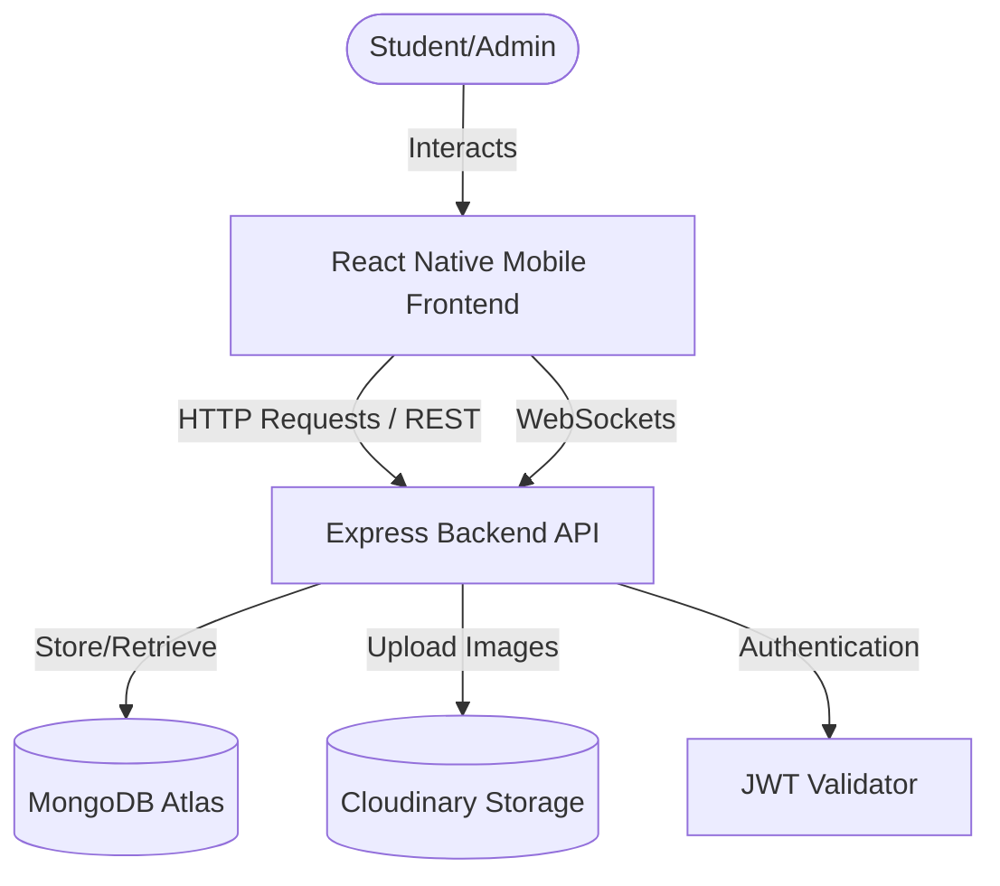

# Implementation Plan - Campus Exchange

Build a **Project Proposal** and a **React Native (Expo) Android mobile application** with a **Node.js + Express + MongoDB Atlas + Cloudinary backend** named **Campus Exchange**, incorporating the requested *Campus Pickup Locations* feature.

---

## Proposed Architecture

We will structure the project as a monorepo in the workspace:
1. `Project_Proposal.md`: Highly professional project proposal document.
2. `backend/`: Node.js Express server.
3. `frontend/`: Expo React Native mobile application.

---

## 1. Project Proposal Document

We will create a markdown document [Project_Proposal.md](file:///c:/Users/ramya/Downloads/Projects/Ecommerce/Project_Proposal.md) with sections:
- Executive Summary & Project Description
- Problem Statement & Objectives
- Target Audience & User Personas
- System Features (User Authentication, Product Management, Search & Filters, Wishlist, Real-time Chat, Campus Pickup Locations, Dashboards)
- Cloud Architecture & Component Workflows (MongoDB Atlas, Cloudinary, Render/Vercel)
- Database Schema Design
- Technical Stack & API Specification
- Timeline & Future Enhancements

---

## 2. Backend Component (`/backend`)

The backend will be built with Node.js, Express, Mongoose, and Socket.io.

### Key Files
- `server.js`: Server initialization, database connection, Express middleware, Socket.io integration.
- `config/db.js`: MongoDB connection setup.
- `models/`: Mongoose schemas.
  - `User.js`: Schema for users (Student/Admin, wishlist, active listings).
  - `Product.js`: Schema for products (name, description, price, condition, images, category, pickupLocation, seller, status: Active/Sold).
  - `Chat.js`: Schema for conversations and messages (sender, receiver, content, timestamp).
- `controllers/`: Request handler logic.
  - `authController.js`: Student signup, login, JWT issuance, optional email format check.
  - `productController.js`: Adding, editing, deleting listings, listing queries with search and filters, marking as sold.
  - `chatController.js`: Fetching chat histories.
  - `adminController.js`: User statistics, removing listings, deleting users, analytics.
- `routes/`: Routing definition.
- `middleware/`: Authentication checks and error handling.
  - `authMiddleware.js`: Verification of JWT token.

---

## 3. Frontend Component (`/frontend`)

The frontend will be built as a React Native mobile application using Expo, enabling the user to run it easily via Expo Go on an Android device.

### Navigation Hierarchy
- **Auth Stack**: Login Screen, Signup Screen.
- **Main Drawer/Tabs Navigation**:
  - **Browse Tab**: Feed of active items with search bar, category filters, and quick view.
  - **Wishlist Tab**: Items saved by the user.
  - **Add Listing Screen**: Form to upload photos, enter price/condition, choose category, select **Campus Pickup Location** (Library, AB1, AB2, Hostel Gate, Food Court, Academic Block).
  - **Chats Tab**: List of active chat threads.
  - **Profile Tab**: User active listings, sold listings, statistics, and logout button.
  - **Admin Dashboard** (Visible to admin role only): Analytics charts (users, products, categories) and listing moderator list.

### Real-Time Chat Screen
- Dynamic interface displaying message bubble exchanges.
- Socket.io integration for instant delivery.

---

## Verification Plan

### Automated Tests & Checks
- API unit tests for backend routers using supertest/jest (if time permits).
- Lint checks for backend and frontend.

### Manual Verification
- **Backend API testing**: Verify endpoints using Postman or cURL scripts.
- **Frontend execution**: Use Expo Go on an Android device or emulator to test pages, navigation flow, mock photo uploads, real-time message sending, and filter selections.
